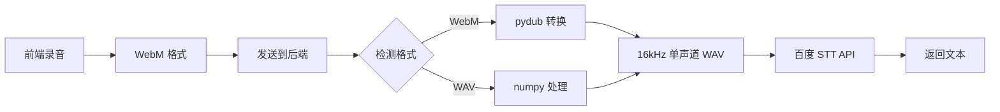

# WebM 音频转换设置指南

## 📋 概述

前端现在直接发送 WebM 格式的录音文件，后端自动将其转换为 WAV 格式后再调用百度语音识别 API。

## 🔧 安装步骤

### 1. 安装 Python 依赖

```bash
pip install pydub>=0.25.1
```

或者更新所有依赖：

```bash
pip install -r requirements.txt
```

### 2. 安装 FFmpeg（必需）

`pydub` 需要 FFmpeg 来处理音频格式转换。

#### Windows 安装

**方式一：使用 Chocolatey（推荐）**
```powershell
choco install ffmpeg
```

**方式二：手动安装**
1. 访问 https://ffmpeg.org/download.html
2. 下载 Windows 版本
3. 解压到某个目录（如 `C:\ffmpeg`）
4. 将 `C:\ffmpeg\bin` 添加到系统 PATH 环境变量

#### macOS 安装

```bash
brew install ffmpeg
```

#### Linux 安装

```bash
# Ubuntu/Debian
sudo apt-get install ffmpeg

# CentOS/RHEL
sudo yum install ffmpeg
```

### 3. 验证安装

```bash
# 检查 FFmpeg 是否可用
ffmpeg -version

# 检查 pydub 是否安装
python -c "from pydub import AudioSegment; print('pydub installed successfully')"
```

## 🚀 使用方法

### 前端（已自动处理）

前端代码已修改为直接发送 WebM 格式：

```typescript
// chat.tsx
const formData = new FormData();
formData.append("file", audioBlob, "recording.webm");  // WebM 格式
formData.append("user", session.id || "default_user");
```

### 后端（自动转换）

后端会自动检测并转换 WebM 格式：

```python
# baidu_stt.py
if audio_format == "webm":
    # 自动转换为 16kHz 单声道 WAV
    normalized_content = self._convert_webm_to_wav(file_content)
    audio_format = "pcm"
```

## 📊 工作流程



## ✅ 优势

1. **前端简化**：无需复杂的音频转换逻辑
2. **文件更小**：WebM 压缩率高，传输更快
3. **统一管理**：后端集中处理音频格式
4. **兼容性更好**：支持多种输入格式（WebM、WAV、MP3 等）

## 🔍 调试

### 查看后端日志

启动后端时会看到转换日志：

```
[STT] Converting WebM to WAV...
[STT] WebM conversion successful, size: 96044 bytes
```

### 常见问题

#### 问题 1：`ImportError: pydub is required`

**解决**：
```bash
pip install pydub
```

#### 问题 2：`FileNotFoundError: [Errno 2] No such file or directory: 'ffmpeg'`

**解决**：安装 FFmpeg（见上方安装步骤）

#### 问题 3：转换失败或音质差

**检查**：
- 确保 FFmpeg 版本较新（建议 4.0+）
- 检查录音质量（避免环境噪音）
- 确认录音时长 > 1 秒

## 📝 技术细节

### 转换参数

- **输入格式**：WebM (Opus/Vorbis 编码)
- **输出格式**：WAV (16-bit PCM)
- **采样率**：16000 Hz
- **声道数**：1（单声道）
- **位深度**：16-bit

### 支持的格式

后端现在支持以下音频格式：

| 格式 | MIME Type | 扩展名 | 转换方式 |
|------|-----------|--------|---------|
| WebM | audio/webm | .webm | pydub → WAV |
| WAV | audio/wav | .wav | numpy → PCM |
| MP3 | audio/mp3 | .mp3 | 直接发送 |
| M4A | audio/m4a | .m4a | 直接发送 |
| AMR | audio/amr | .amr | 直接发送 |

## 🎯 测试

1. 启动后端服务：
   ```bash
   python main.py
   ```

2. 启动前端服务：
   ```bash
   cd NextChat
   yarn dev
   ```

3. 测试录音功能：
   - 点击"语音"按钮
   - 说话 3-5 秒
   - 再次点击停止
   - 查看后端日志确认转换成功
   - 验证识别结果

## 📚 相关文档

- [pydub 官方文档](https://github.com/jiaaro/pydub)
- [FFmpeg 官方网站](https://ffmpeg.org/)
- [百度语音识别 API](https://ai.baidu.com/tech/speech/asr)
